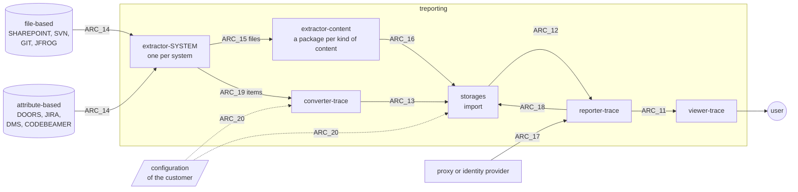

# System architecture (r3)

The subsystems of treporting, their interfaces, and which subsystems realize each system
requirement (r2).

**Figure overview** - the subsystems of treporting and their interfaces



**Table subsystems** - the short form of each subsystem

| Short form | Subsystem | Id |
|---|---|---|
| V | viewer-trace | ARC_01 |
| R | reporter-trace | ARC_02 |
| S | storages | ARC_03 |
| C | converter-trace | ARC_04 |
| EC | extractor-content | ARC_05 |
| ES | extractor-SYSTEM | ARC_06 |

There are two kinds of system:

- **file-based** systems - SHAREPOINT, SVN, GIT, JFROG - only manage files: the content lies in
  the folders and files themselves. extractor-content reads it, with a package for each kind of
  content and no plug-in mechanism.
- **attribute-based** systems - DOORS, JIRA, a DMS, CODEBEAMER - hold items whose attributes are
  customized by each customer. The converter maps those attributes to the model, by a
  configuration file of the customer.

Every system has an extractor of its own that lists and fetches what it holds. Converter,
storage and reporter speak one language, the information model (ARC_21), whose contract is
[attributes.md](attributes.md). Our own data in YAML has the schemas of ARC_22 as its contract, in
[schemas/](../schemas/); each schema names it as `@refines ARC_22`, and is a draft of the gel schema. Both ways end in
the import of the storage, which works the same for every system. Each subsystem is a repo of
its own. r4 is the allocation in this file: the system requirements allocated to a subsystem are
its requirements, derived directly from r2, with no ids of their own. The document is written
for whoever derives the software requirements of a subsystem (r5) from it.

The terms - system, item, content, work product, release, library, baseline - are those of
[definitions.md](../definitions.md). The levels follow ISO/IEC/IEEE 12207 as set out in the section
Process of [harness.md](../harness.md); this file is r3, the architecture definition of
ISO/IEC/IEEE 12207, 6.4.4.

The ids are `ARC_nn` for the subsystems and interfaces, `ARCR_nn` for the rationale and
`ARCD_nn` for the decisions; a requirement that a decision made possible names it as its
uplink. The elements, the allocation and the ids of rationale and decisions are in
[system-architecture.yaml](system-architecture.yaml), in the format of [formats.md](../formats.md).

## Rationale

The principles every decision below follows.

### ARCR_01 Read only

treporting only reads the data of its users. It never writes into a source system
and never holds data that a user enters into treporting itself. What it writes are records of
its own: the data set as read, the derived values beside it, the import records, the record of
every report and the audit trail.

**Example**: a finding of the plausibility analysis is evaluated where the customer works - an
attribute in DOORS, a ticket in JIRA linked to the requirement -, and treporting reads that
evaluation like any other data. The approval of a release is made where the organization makes
it, and names the report it relied on.

**Why**: we do not know how others work, so treporting fits into what is there instead of
prescribing a way of working. What a user decides stays in the system where it is evidence
without treporting. And treporting needs no input of its own - no rights to enter data, no
audit trail of entries, no second place where the truth could be.

**What it rules out**: evaluating findings or approving releases in treporting - it would leave
the maxim, and bring a way of working, an audit trail of entries and a second truth with it.

## Decisions

### ARCD_01 Independent count (SYS_23)

**Decision**: the source is counted by a query of its own (ARC_14), in the extractor of the system
but in code apart from the reader, and the stored count is taken from the storage after the import. A reader never
reports what it read as the count of the source. Besides, a verifier of its own, apart from all
subsystems, checks the data of treporting itself (the reference edgedb) and is run on request,
for instance by an assessor; it is not delivered with the product.

**Example**: a CODEBEAMER tracker holds 1 200 requirements, read in pages of 500. A fault in the
paging drops the last page, so 1 000 are read. A reader that counts what it reads reports
1 000 in the source, 1 000 read, 1 000 stored - all equal, and wrong. The query of its own asks
for the total and gets 1 200; the difference of 200 marks the data set incomplete. On the other
side, two requirements share an id in the source: 1 200 are read, the second overwrites the first,
and only a count taken from the storage afterwards shows 1 199. In code, an `@implements` written
over two lines is missed by the reader and found by a plain `git grep -c '@implements'`.

**Why**: a count made by the reader shares every error of the reading, so it cannot find one. Only
a count on another way detects the errors of an import with high confidence - which is what tool
error detection TD1 asks for, and what keeps treporting at TCL1 without qualification (see
Integrity in the system requirements). The verifier goes one step further, independent of the
whole product; it costs a repo of its own, so it is kept for the own data and for the cases where
an assessor asks for it, rather than run on every import.

**Rejected**: the reader counting for itself - cheap, but it misses exactly the faults above.

### ARCD_02 Import record (SYS_26, SYS_41)

**Decision**: the import of the storage brings the four counts together - the count of the
source from the extractor of the system, read and refused from extractor-content or
the converter, stored from the storage itself -, so it sets the state
of the data set - complete, incomplete, or unverified when the source has no count of its own - and
keeps the import record. The storage keeps the record with the data set,
the reporter hands the state on with every answer, the viewer shows it on every view.

**Example**:

```
import 2026-10-23T14:02:11Z  by m.fischer
  source        codebeamer, tracker 4711, revision 3812
  converter     converter-trace v1.4.0, configuration acme-codebeamer v7
  data set      release-2.1
  counted       requirement: source 1200, read 1000, refused 0, stored 1000
                link parentOf: source 3400, read 2890, refused 0, stored 2890
  refused       -
  fingerprints  1000 compared, 0 differ
  state         incomplete  (requirement -200, link parentOf -510)
```

**Why**: the record carries the trace of a report past the data set to the source and its
revision (REG_FDADI_01), it is the audit trail of a change of data (REG_CFR21-11_01), and it is the evidence that
errors of an import are detected (REG_ISO26262-8_01, REG_IEC61508-3_01, REG_DO178C_01, REG_DO330_01).

### ARCD_03 Original and derived values (SYS_11)

**Decision**: the storage always keeps the original as read from the source. A value derived at
the import is never the original and is kept beside it under a name of its own, with a
prefix: `M` for a value mapped - unified, translated or adapted to the model; where the original
is empty, the mapped value of the parent -, `I` for an intermediate form, only for the status, where
the original has to be transformed before it can be mapped. When a rule changes, the derived values can be made again on the stored data set,
back in time, so that the data need not be fetched from the source systems again - a requirement
that follows from this architecture, not from a need (SYS_69).

**Example**: the source says `Status = 'im Review'`; the import keeps it and adds
`MStatus = 'review'`, as the configuration of the customer maps it. A status kept per platform -
`Status = "status_platform-1 = in Review_Vendor` / `status_platform-2 = open"` - is first transformed
into `IStatus = "platform-1 = in Review` / `platform-2 = open"`; `MStatus` is then `review` when the
filter selects platform-1, made for the filter set where it is not stored. A software requirement
without a safety class under parents of ASIL B and QM keeps `Safety` empty and gets
`MSafety = 'ASIL B'`; its test case and test result get `MSafety = 'ASIL B'` as well.

**Why**: what is stored can be compared with the source (SYS_25) and stays original (REG_FDADI_01).
Where the evidence is that every requirement was classified by a person, the report shows
`Safety`, not `MSafety`; where the evidence is that nothing falls out of a filter, it shows
`MSafety`. A change of a rule needs no new import. Only a derived value that is stored can be
checked for plausibility - the reporter finds an original `Safety = 'QM'` under a parent
with `MSafety = 'ASIL D'` in its analysis (SYS_70); the import reads the data as it is.

**Rejected**:

- the reporter derives the values when it answers, and nothing derived is stored. It keeps the
  rule in one place and the storage plain, but a derived value then exists only in an answer:
  it cannot be checked for plausibility, compared between two reports, or shown to an auditor
  as what the report was made from.
- the storage derives them in a view of the database. It binds the rule to the database, and the
  data file (SYS_21) would need the rule a second time.

### ARCD_04 Configuration instead of code for the customer (SYS_22)

**Decision**: what differs from customer to customer - the customized attributes of an
attribute-based system and the values to be mapped - is a configuration file, read by one
general mechanism: the converter for the attributes, the import of the storage for the
values. Only what a configuration cannot say goes into code of its own, in a private repo per
system and customer, such as converter-doors-acme.

**Example**: one customer keeps the safety class of a requirement in the DOORS attribute
`ASIL_Rating`, another in `Safety Level`, with the values `QM, A, B, C, D` or `none, ASIL A, ...`.
Two configuration files map both to `Safety` and their values to `MSafety`; the code is the same.

**Why**: the formats of a customer are proprietary and must not reach the public repos. A
configuration stays with the customer; the mechanism stays public and is tested once for all.

**Rejected**: a converter in code per system - the proprietary formats would be in code, and the
same mechanics would be written once per system.

### ARCD_05 Identity (SYS_39)

**Decision**: treporting keeps no users and no passwords of its own. It takes the identity from
what the organization already has: preferably from a proxy in front of it that authenticates the
user and hands the identity and the groups on - transparent, treporting needs no logic of its
own for it -, and where possible from the identity provider of the organization over a standard
protocol (OIDC). The organization maps its groups to the roles of treporting by configuration.

**Example**: a supplier runs treporting in its own network; its people log in everywhere with
their company account. When someone leaves, the one account is locked, and treporting is closed
to them at the same moment - there is nothing to lock in treporting.

**Why**: we do not know how others manage their users, so treporting fits into what is there
instead of bringing a second management. A proxy keeps that entirely outside treporting.

**Rejected**: a user management of its own in treporting - a second place to lock an account,
and the duty of keeping passwords.

## Allocation

The allocation of every system requirement to the subsystems is the field `allocated` of each subsystem in [system-architecture.yaml](system-architecture.yaml).

## Open

- `treporting = 4_selfhosted` - **Licensed features**: not decided where their source lives and how
  the licence of an installation is proved. None exists yet. They would be in the product, checked
  per route - role, rights, licence -, under the Elastic License 2.0, in a directory of their own
  per repo.
- `treporting = 1_demo` - **Repos**: the repos of extractor-content and of the extractors per system
  are not created yet. reporter-annotations becomes the package annotations of extractor-content.

## Change history

| Version | Date | Change | Reason | By |
|---|---|---|---|---|
| 1.1.1 | 2026-10-30 | - | #327 | Claude Opus 5.5 and Mathias Fischer, authors; Mathias Fischer, reviewer |
| 2.1.1 | 2026-10-30 | System architecture; Decisions | #334 | Claude Opus 5.5, author; Mathias Fischer, reviewer |
