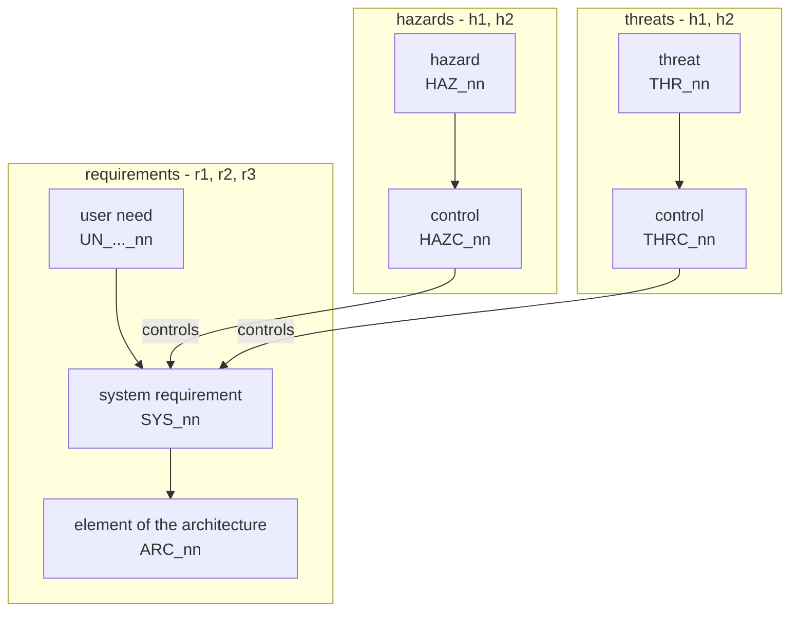

# Hazard and risk analysis

The hazards treporting can cause, by the method of IEC 61508-1, 7.4. treporting controls nothing; it is a
tool that people rely on when they decide on a release. Its hazards are therefore wrong
information that leads to a wrong decision - a product released with a gap that treporting did
not show.

**Figure trees** - how a hazard or a threat reaches the requirements

The hazards are on level h1, with the ids `HAZ_nn`. Each hazard is controlled by a control on level
h2, with the ids `HAZC_nn`. Each control asks for a
system requirement (r2) that realizes it.

The threats of security share level h1, with the ids `THR_nn`. Each threat is controlled by a
control on level h2, with the ids `THRC_nn`. Whether treporting gets a threat analysis is not
decided yet - see Open in [harness.md](../harness.md).

The hazards and their controls are in [hazards.yaml](hazards.yaml), in the format of
[formats.md](../formats.md). If treporting gets a tool qualification, its analysis of tool errors
builds on this file. The document is written for whoever derives the system requirements from the
controls, and for an assessor.

## Risk

If treporting is used to decide whether a product can be released, and it shows something wrong, a
product with a gap may be released. The severity of a hazard is the severity of that product's
failure. treporting does not know it. So the risk is not rated, but kept low by detection: every
hazard is either prevented by its control, or shown to the user as the linked system
requirement defines.

## Open

- `treporting = 3_tools` - **Tool qualification**: the tool qualification package is not made yet.
  Its analysis of tool errors builds on this file and shows whether this analysis is complete.

## Change history

| Version | Date | Change | Reason | By |
|---|---|---|---|---|
| 1.1.1 | 2026-10-30 | - | #329 | Claude Opus 5.5 and Mathias Fischer, authors; Mathias Fischer, reviewer |
