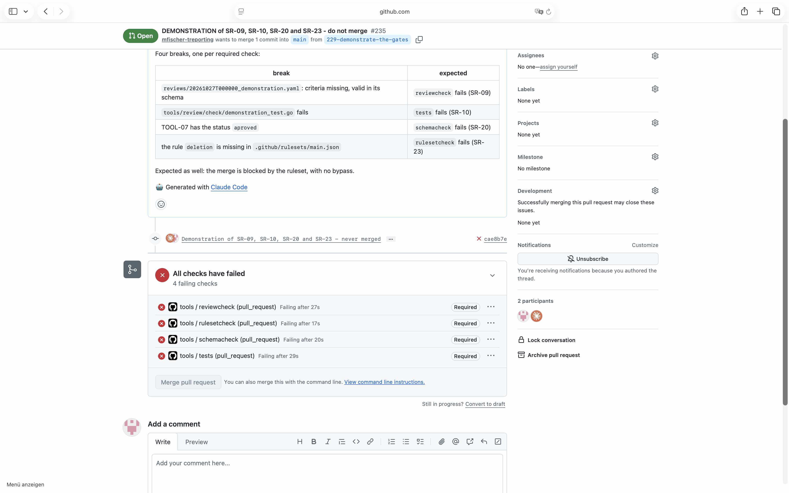

# Demonstration of SR-23

## Requirement

SR-23: on every pull request, in .github/workflows/tools.yml, check the ruleset of main against .github/rulesets/main.json, and fail where they differ; a pull request whose check failed cannot be merged

## Configuration

- the workflow `.github/workflows/tools.yml` and the tools as on `main` at `cad6761`
- the ruleset of `main` as in `.github/rulesets/main.json` at `e7b864b`, with the required checks
  reviewcheck, tests, schemacheck and rulesetcheck, and no bypass

## Steps

1. From `main` at `cad6761`, open a pull request with one break for each required check. For
   SR-23: the rule deletion taken out of .github/rulesets/main.json.
2. Wait until the checks of the pull request have run.
3. Read the log of the job rulesetcheck, and the state of the merge of the pull request.
4. Close the pull request unmerged.

The test pull request was #235, its commit `cae8b7e`. GitHub keeps both after it is closed.

## Expected

The required check rulesetcheck fails on the break, and the merge of the pull request is blocked.

## Observed

From the log of rulesetcheck:

```
rules/deletion: on GitHub, not in the file
the ruleset of main checked against .github/rulesets/main.json, 1 findings
```

The pull request: `mergeStateStatus` BLOCKED. The screenshot shows the four failed required checks
and the button Merge pull request disabled:



## Verdict

Passed: the break failed the required check rulesetcheck, and the merge was blocked.
