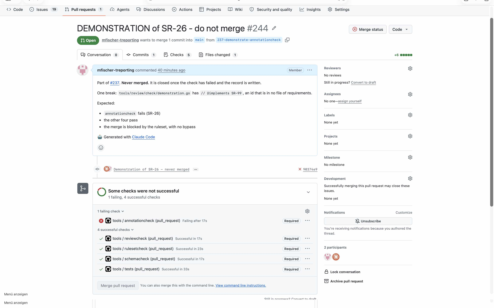

# Demonstration of SR-26

## Requirement

SR-26: on every pull request, in .github/workflows/tools.yml, check the annotations against the base commit, and fail where one names an id that is missing or not approved there; a pull request whose check failed cannot be merged

## Configuration

- the workflow `.github/workflows/tools.yml` and the tools as on `main` at `79a02f4`
- the ruleset of `main` as in `.github/rulesets/main.json` at `c3d4aeb`, with the required checks
  reviewcheck, tests, schemacheck, rulesetcheck and annotationcheck, and no bypass

## Steps

1. From `main` at `79a02f4`, open a pull request with one break: `tools/review/check/demonstration.go`
   with the annotation `@implements SR-99`, an id that is in no file of requirements.
2. Wait until the checks of the pull request have run.
3. Read the log of the job annotationcheck, and the state of the merge of the pull request.
4. Close the pull request unmerged.

The test pull request was #244, its commit `90374e9`. GitHub keeps both after it is closed.

## Expected

The required check annotationcheck fails on the break, the other four pass, and the merge of the
pull request is blocked.

## Observed

From the log of annotationcheck:

```
tools/review/check/demonstration.go:5 @implements SR-99: not in tools/software-requirements.yaml in the base commit 79a02f4
59 annotations, 108 ids, checked against the base commit 79a02f4, 1 findings
```

The pull request: `mergeStateStatus` BLOCKED. The screenshot shows annotationcheck failed and
required, the other four checks passed, and the button Merge pull request disabled.



## Verdict

Passed: the break failed the required check annotationcheck, and the merge was blocked.
