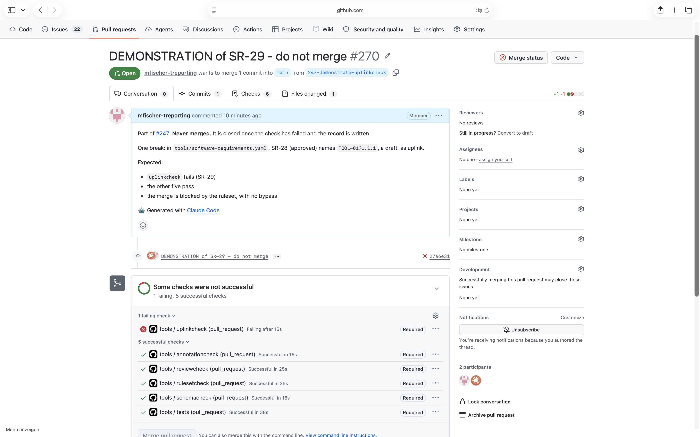

# Demonstration of SR_29

## Requirement

SR_29: on every pull request, in .github/workflows/tools.yml, check the uplinks of the approved requirements, and fail where one is not approved; a pull request whose check failed cannot be merged

## Configuration

- the workflow `.github/workflows/tools.yml` and the tools as on `main` at `2cb7b8c`
- the ruleset of `main` as in `.github/rulesets/main.json` at `92d2065`, with the required checks
  reviewcheck, tests, schemacheck, rulesetcheck, annotationcheck and uplinkcheck, and no bypass

## Steps

1. From `main` at `2cb7b8c`, open a pull request with one break: in
   `tools/software-requirements.yaml`, SR_28, which is approved, names `TOOL_01@1.1.1`, a draft, as
   uplink.
2. Wait until the checks of the pull request have run.
3. Read the log of the job uplinkcheck, and the state of the merge of the pull request.
4. Close the pull request unmerged.

The test pull request was #270, its commit `27a6e31`. GitHub keeps both after it is closed.

## Expected

The required check uplinkcheck fails on the break, the other five pass, and the merge of the pull
request is blocked.

## Observed

From the log of uplinkcheck:

```
SR-28 names TOOL-01@1.1.1: draft, not approved
82 approved requirements checked, 1 findings
```

The pull request: `mergeStateStatus` BLOCKED. The screenshot shows uplinkcheck failed and required,
the other five checks passed, and the button Merge pull request disabled.



## Verdict

Passed: the break failed the required check uplinkcheck, and the merge was blocked.
