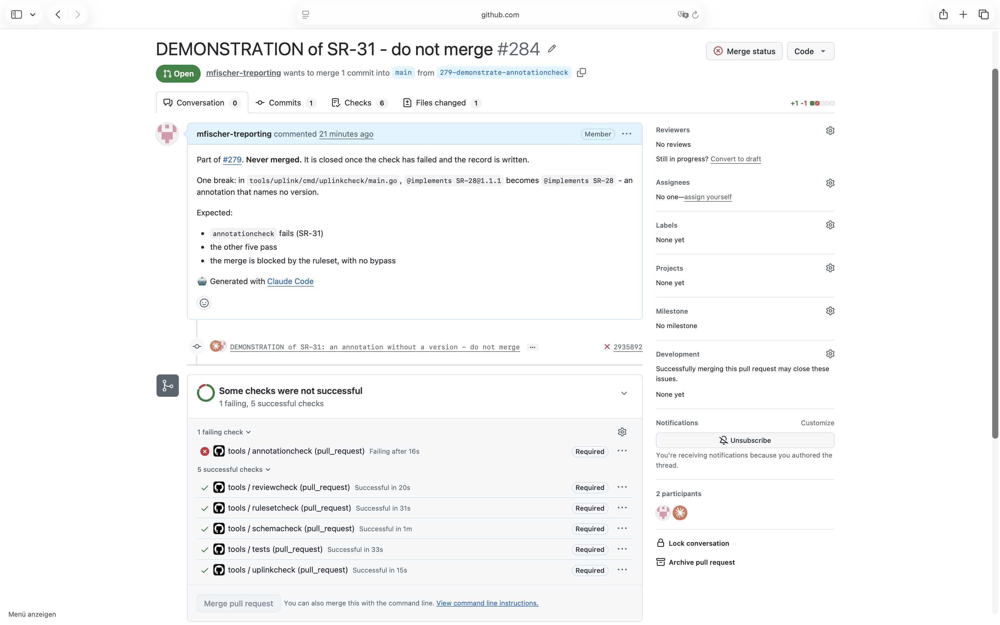

# Demonstration of SR-31

## Requirement

SR-31: on every pull request, in .github/workflows/tools.yml, fail where an annotation names no version; a pull request whose check failed cannot be merged

## Configuration

- the workflow `.github/workflows/tools.yml` and the tools as on `main` at `3cde702`
- the ruleset of `main` as in `.github/rulesets/main.json` at `92d2065`, with the required checks
  reviewcheck, tests, schemacheck, rulesetcheck, annotationcheck and uplinkcheck, and no bypass

## Steps

1. From `main` at `3cde702`, open a pull request with one break: in
   `tools/uplink/cmd/uplinkcheck/main.go`, `@implements SR-28@1.1.1` becomes `@implements SR-28`.
2. Wait until the checks of the pull request have run.
3. Read the log of the job annotationcheck, and the state of the merge of the pull request.
4. Close the pull request unmerged.

The test pull request was #284, its commit `2935892`. GitHub keeps both after it is closed.

## Expected

The required check annotationcheck fails on the break, the other five pass, and the merge of the
pull request is blocked.

## Observed

From the log of annotationcheck:

```
tools/uplink/cmd/uplinkcheck/main.go:18 @implements SR-28: names no version, as SR-28@x.y.z
67 annotations, 117 ids, checked against the base commit 3cde702, 1 findings
```

The pull request: `mergeStateStatus` BLOCKED. The screenshot shows annotationcheck failed and
required, the other five checks passed, and the button Merge pull request disabled.



## Verdict

Passed: the break failed the required check annotationcheck, and the merge was blocked.
