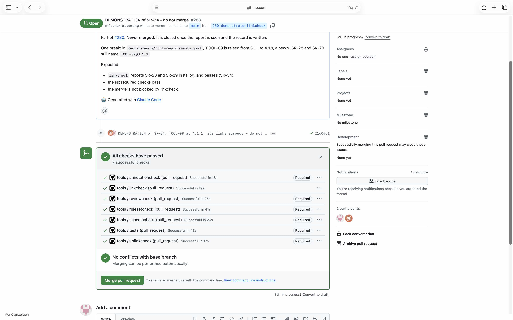

# Demonstration of SR_34

## Requirement

SR_34: on every pull request, in .github/workflows/tools.yml, make the link check in a job of its own and show its report in the log, without failing

## Configuration

- the workflow `.github/workflows/tools.yml` and the tools as on `main` at `cda1b40`
- the ruleset of `main` as in `.github/rulesets/main.json` at `92d2065`, with the required checks
  reviewcheck, tests, schemacheck, rulesetcheck, annotationcheck and uplinkcheck, and no bypass;
  linkcheck is not one of them

## Steps

1. From `main` at `cda1b40`, open a pull request with one break: in
   `requirements/tool-requirements.yaml`, TOOL_09 is raised from 3.1.1 to 4.1.1, a new x. SR_28 and
   SR_29 still name `TOOL_09@3.1.1`.
2. Wait until the checks of the pull request have run.
3. Read the log of the job linkcheck, the required checks of the pull request, and the state of its
   merge.
4. Close the pull request unmerged.

The test pull request was #288, its commit `21c04d1`. GitHub keeps both after it is closed.

## Expected

The job linkcheck reports SR_28 and SR_29 in its log and passes. The six required checks pass, and
linkcheck does not block the merge.

## Observed

From the log of linkcheck:

```
SR-28 source_ids names TOOL-09@3.1.1: its object has 4.1.1
SR-29 source_ids names TOOL-09@3.1.1: its object has 4.1.1
455 links and 125 ids of annotations compared, 2 suspect
```

The job linkcheck passed. `gh pr checks 288 --required` listed six checks, all passed:
annotationcheck, reviewcheck, rulesetcheck, schemacheck, tests and uplinkcheck. The pull request:
`mergeStateStatus` CLEAN. The screenshot shows the seven checks passed, linkcheck without the mark
Required, and the button Merge pull request enabled.



## Verdict

Passed: the job linkcheck showed both suspect links in its log and did not fail, and it did not
block the merge.
