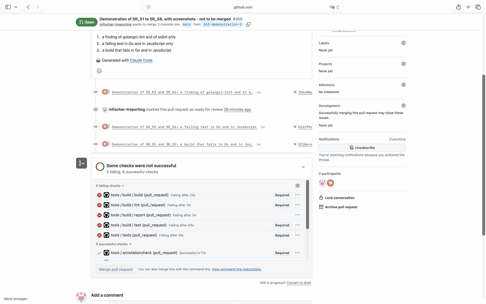

# Demonstration of SR_51 and SR_52

## Requirement

SR_51: in build.yml, build every Go module of the repo - every directory with a go.mod - and fail where one does not build

SR_52: in build.yml, install with `npm ci` and build with `npm run build` every JavaScript package of the repo - every directory with a package-lock.json - and fail where one does not build

## Configuration

- the workflow `.github/workflows/build.yml`, called by the job `build` of
  `.github/workflows/tools.yml`, and `.github/build` as on `main` at `d819adc` - the merge of the
  build steps - and on the branch of the test pull request
- the ruleset of `main` as in `.github/rulesets/main.json` at `0f283dd`, with the required checks
  `build / build`, `build / lint` and `build / test`, and no bypass
- the Go module `tools`, with a package `tools/demo` added for the demonstration, and a JavaScript
  package `demo-js` with the scripts `build` and `test`

## Steps

1. From `main`, open the test pull request #359 with three commits, one after the other, each pushed
   alone:
   1. `7bbc00a`: a finding of golangci-lint - an error of `os.Remove` not checked - and of eslint -
      an import never used
   2. `b16199c`: no finding; a test in Go and one in JavaScript that fail
   3. `52104c4`: a Go file that does not compile, and a script `build` that throws
2. After each push, wait until every check has run, read the logs of the jobs `build / build`,
   `build / lint`, `build / test` and `build / report`, and take a screenshot of the merge of the
   pull request, with the button Merge pull request in view.
3. Close #359 unmerged.
4. The screenshots of the first two commits did not show all checks done and the button: repeat
   them in the test pull request #360, from `main`, with the same two breaks - `8a906f8` and
   `1eb8e34` - and step 2.
5. Close #360 unmerged.

GitHub keeps both pull requests and their commits after they are closed.

## Expected

The job build / build fails where a Go module or a JavaScript package does not build, and the merge of the pull request is blocked.

## Observed

From the log of the run at `52104c4`:

```
demo/demo.go:5:25: cannot use "2" (untyped string constant) as int value in return statement
FAIL ./tools: go build ./...
Error: the build fails on purpose
FAIL ./demo-js: npm run build
build / build: fail (required)
build / lint, build / test, build / report, tools / tests: fail - nothing else runs where nothing builds
the pull request: mergeStateStatus BLOCKED
```

The screenshot of the pull request after the run:



## Verdict

Passed: the build of the Go module and of the JavaScript package failed the required check `build / build` at `52104c4`, and the merge was blocked. At `7bbc00a` and `b16199c`, where both built, `build / build` passed.
