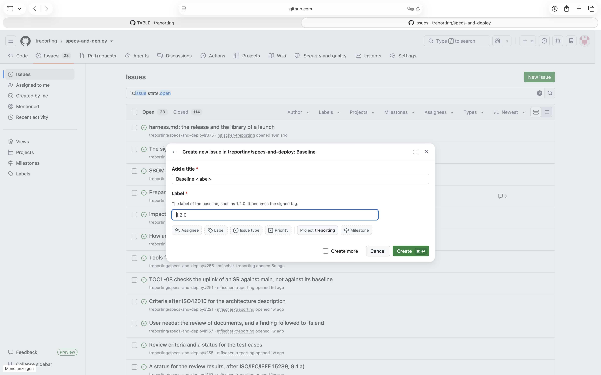
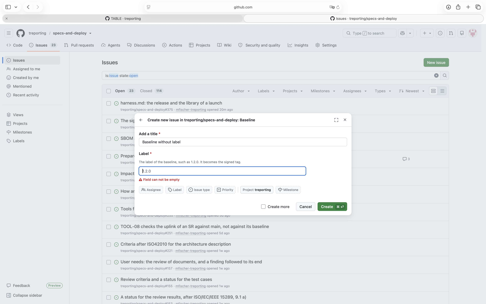
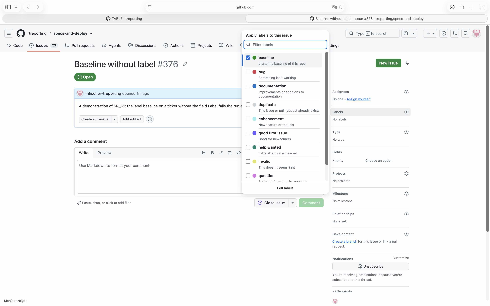
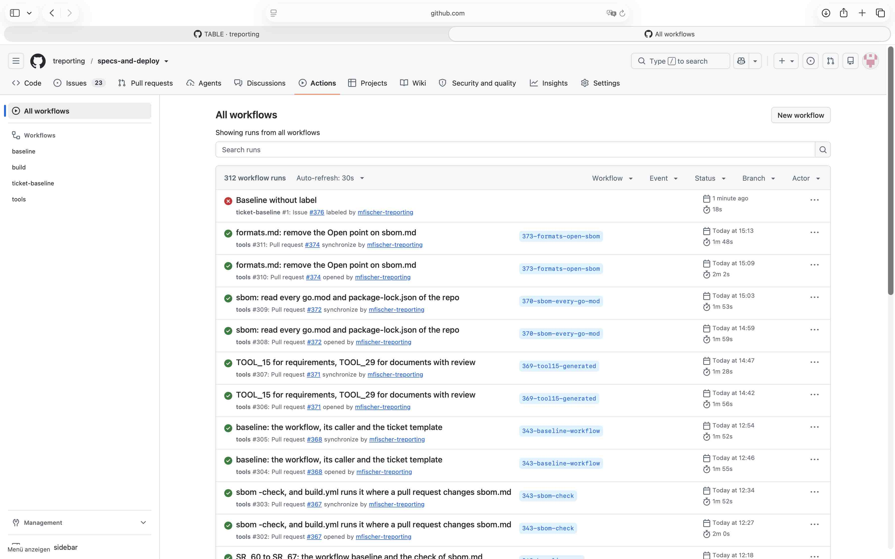
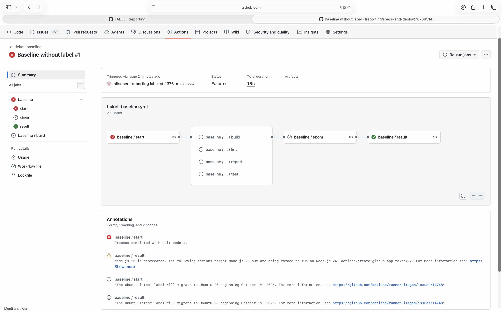
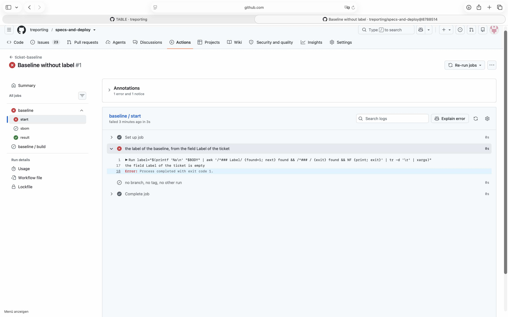
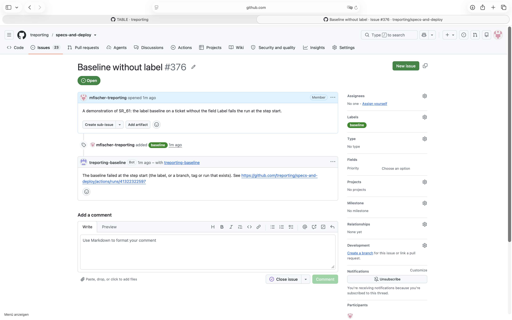

# Demonstration of SR_60, SR_61 and SR_65 with a ticket without a label

## Requirement

SR_60: provide the ticket template Baseline with the field Label; it sets no label on the ticket

SR_61: start baseline.yml when the label `baseline` is set on a ticket of the repo, with the label of the baseline from the field Label; fail where it is empty

SR_65: name the result in the ticket, as a comment: the pull request, or the step that failed - here the step that failed

## Configuration

- `.github/ISSUE_TEMPLATE/baseline.yml`, `.github/workflows/ticket-baseline.yml` and
  `.github/workflows/baseline.yml` as on `main` at `8788514`
- the GitHub App `treporting-baseline`, owned by the org, installed on selected repos with Contents,
  Issues and Pull requests read and write and Metadata read; the variable `BASELINE_APP_ID` and the
  secret `BASELINE_APP_PRIVATE_KEY` of the org; the label `baseline` of specs-and-deploy - set up as
  devops.md, section Baseline, describes it at `4d2c738`

## Steps

1. Issues, New issue, Baseline: look at the form, then try to create it with the field Label empty.
2. Create ticket #376 without the template - `gh issue create` - so that it has no field Label.
3. Set the label `baseline` on #376.
4. Read the run of ticket-baseline it started, the log of its job start, and the comments of #376.

## Expected

The ticket template Baseline has the field Label and sets no label; where the field Label is empty,
the label baseline starts baseline.yml, the job start fails, and the ticket gets a comment naming
the step start.

## Observed

The form Baseline has the field Label, required, and no label is set. With the field Label empty, it
cannot be created:





The label set on #376, and the run it started at `8788514`:







From the log of the job start:

```
the field Label of the ticket is empty
Error: Process completed with exit code 1.
```



The comment on #376:

```
treporting-baseline: The baseline failed at the step start (the label, or a branch, tag or run that exists). See https://github.com/treporting/specs-and-deploy/actions/runs/41322322597
```



## Verdict

Passed: the template has the field Label and sets no label; with the field Label empty, the run
failed at start, built nothing, and named the step start in the ticket. The form itself already
refuses an empty field Label; a ticket without it comes from outside the form, as here.
