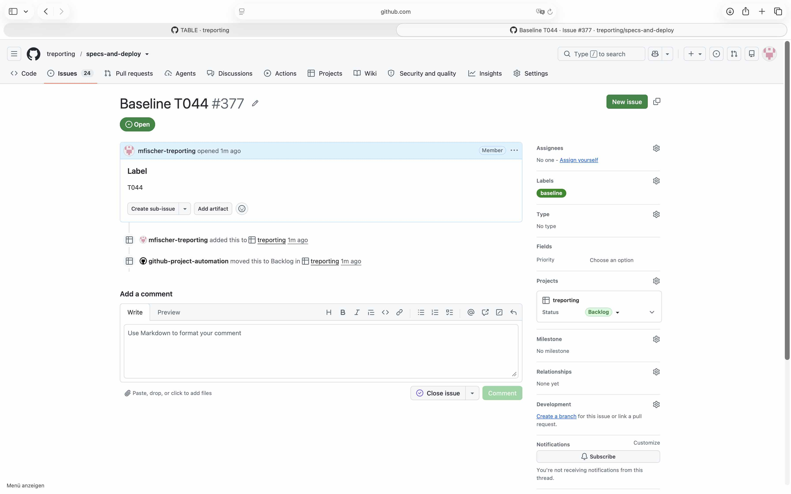
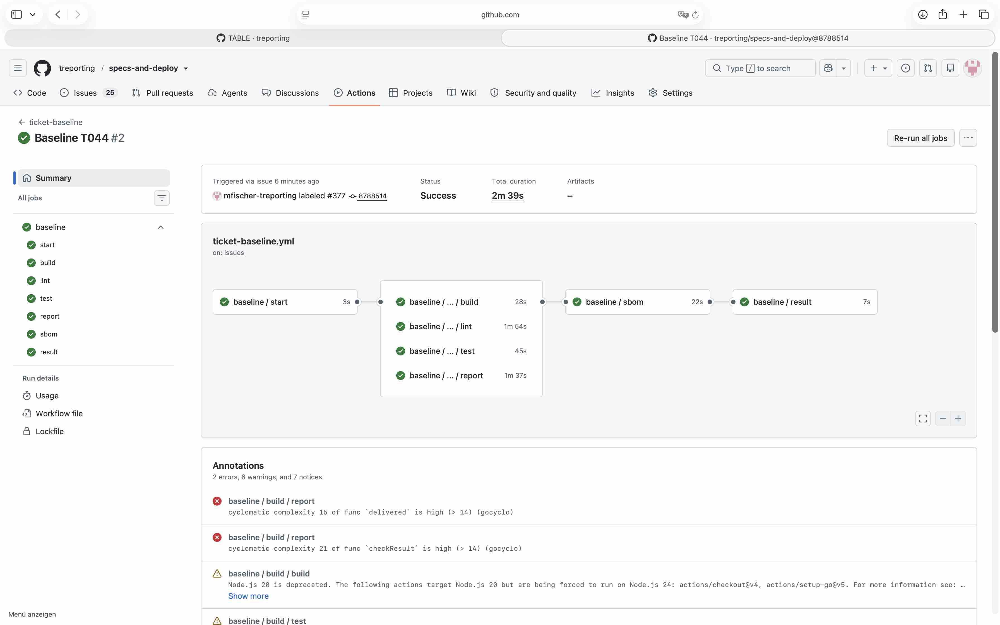
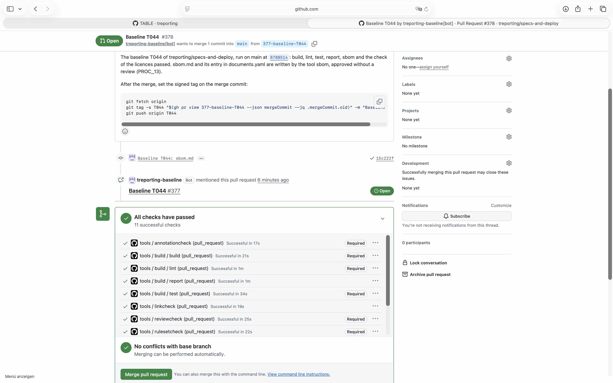
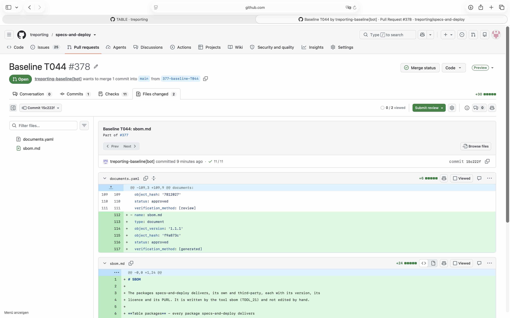
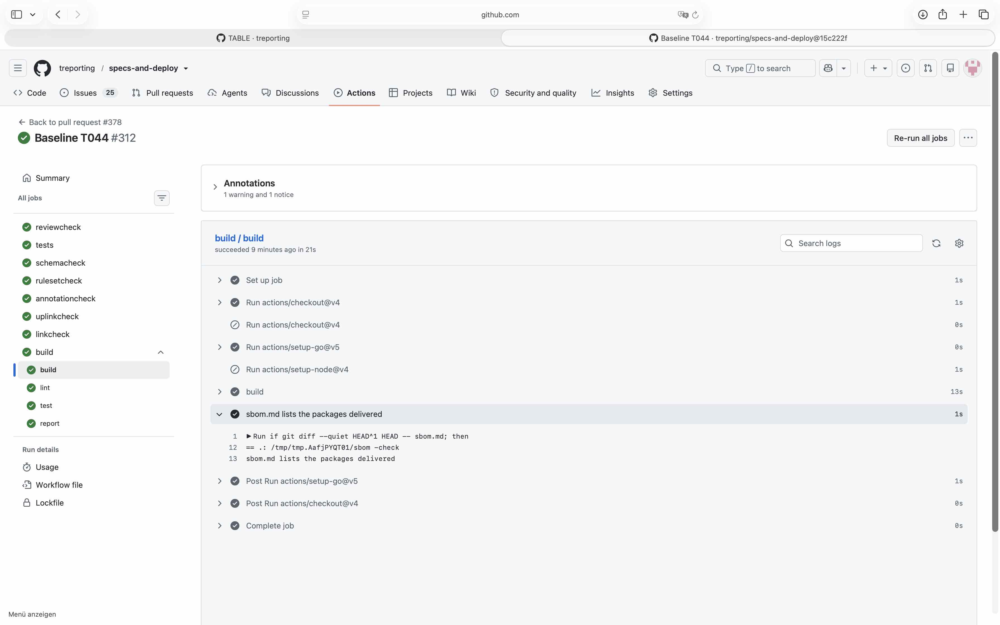
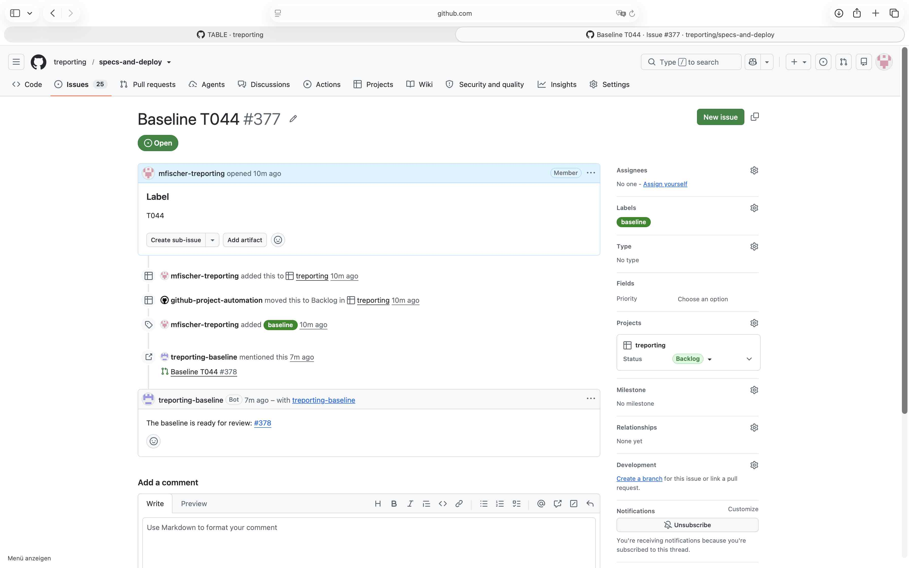

# Demonstration of SR_61, SR_63, SR_64, SR_65 and SR_67 with the baseline T044

## Requirement

SR_61: start baseline.yml when the label `baseline` is set on a ticket of the repo, with the label of the baseline from the field Label; fail where it is empty - here the start

SR_63: run on the head of main the jobs build, lint, test and report of build.yml, then sbom with the label, the ticket and the images the caller names, built at that head, then licencecheck

SR_64: where every step passes, push the branch `<ticket number>-baseline-<label>` with sbom.md and documents.yaml in one commit, and open a pull request with a token of the GitHub App, naming the ticket, the label, the commit of main it ran on, and the command for the signed tag

SR_65: name the result in the ticket, as a comment: the pull request, or the step that failed - here the pull request

SR_67: in build.yml, run sbom with `-check` where the pull request changes sbom.md, with the images the caller names

## Configuration

- `.github/ISSUE_TEMPLATE/baseline.yml`, `.github/workflows/ticket-baseline.yml`,
  `.github/workflows/baseline.yml`, `.github/workflows/build.yml` and `.github/build` as on `main`
  at `8788514`; the caller names no images
- the GitHub App `treporting-baseline`, its variable and secret, and the label `baseline`, set up as
  devops.md, section Baseline, describes it at `4d2c738`
- the ruleset of `main` as in `.github/rulesets/main.json`

## Steps

1. Issues, New issue, Baseline: title Baseline T044, field Label `T044`; ticket #377.
2. Set the label `baseline` on #377.
3. Read the run of ticket-baseline it started, the pull request it opened, the checks of the pull
   request, and the comments of #377.
4. Leave the pull request open for the demonstration of SR_62.

## Expected

The label baseline on a ticket with the field Label T044 starts baseline.yml; build, lint, test and
report, sbom and licencecheck pass on the head of main; the App opens a pull request from the branch
377-baseline-T044 with sbom.md and documents.yaml in one commit, whose checks run and pass, the check
of sbom.md among them; the ticket gets a comment naming the pull request.

## Observed

The ticket with the field Label T044 and the label baseline:



The run at `8788514`, every job passed:



From the log of the job sbom:

```
sbom.md written: 5 packages, version 1.1.1
5 packages checked, 0 fail
```

The pull request #378, opened by `treporting-baseline[bot]` from `377-baseline-T044`; its body names
T044, `8788514` and the command for the signed tag, its commit `15c222f` the ticket; all 11 checks
passed:





The check of sbom.md in `build / build` at `15c222f`:

```
== .: /tmp/tmp.AafjPYQT01/sbom -check
sbom.md lists the packages delivered
```



The comment on #377:



The job report of the run named `delivered` of sbom with a cyclomatic complexity of 15, above 14;
report does not gate, and the finding is followed in #379.

## Verdict

Passed: the run made the loop on the head of main, wrote sbom.md and its entry, checked the
licences, pushed one commit on the branch of the ticket and opened the pull request with the token
of the App, so that its checks ran - the check of sbom.md among them - and named the pull request in
the ticket.
