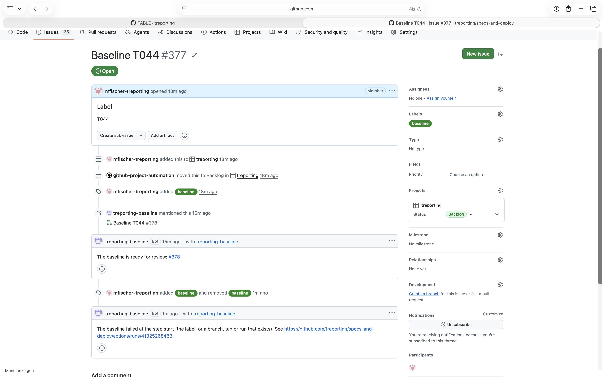

# Demonstration of SR_62 and SR_65 with a branch of the baseline that exists

## Requirement

SR_62: fail where the branch `<ticket number>-baseline-<label>` or the tag `<label>` exists, or another run of baseline.yml of the repo is in progress - here the branch

SR_65: name the result in the ticket, as a comment: the pull request, or the step that failed - here the step that failed

## Configuration

As in the demonstration of the baseline T044 (20261101T165659_baseline-t044.md), after it: the
branch `377-baseline-T044` exists, and its pull request #378 is open.

## Steps

1. Remove the label `baseline` from #377, and set it again.
2. Read the run of ticket-baseline it started, the log of its job start, and the comments of #377.

## Expected

The label baseline set again on #377, whose branch 377-baseline-T044 exists, fails the run at the
step start, builds nothing, and the ticket gets a comment naming the step start.

## Observed

From the run 41325268453 at `8788514`: start failed, build and sbom were skipped, result passed.
From the log of the job start:

```
the branch 377-baseline-T044 exists
```

The ticket, with the label set again and the comment:



## Verdict

Passed: with the branch of the ticket and the label there, the run failed at start, built nothing,
and named the step start in the ticket. The tag that exists is shown in
20261101T173742_baseline-tag.md; the other run in progress takes the same step and is not shown.
