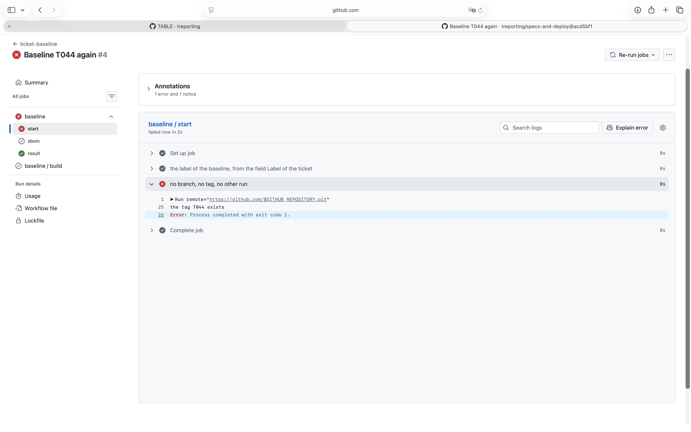

# Demonstration of SR_62 and SR_65 with a tag of the baseline that exists

## Requirement

SR_62: fail where the branch `<ticket number>-baseline-<label>` or the tag `<label>` exists, or another run of baseline.yml of the repo is in progress - here the tag

SR_65: name the result in the ticket, as a comment: the pull request, or the step that failed - here the step that failed

## Configuration

As in the demonstration of the baseline T044 (20261101T165659_baseline-t044.md), after it: its pull
request #378 merged at `acd5bf1`, and the signed tag `T044` set on that commit and pushed; GitHub
shows it verified.

## Steps

1. Issues, New issue, Baseline: title Baseline T044 again, field Label `T044`; ticket #381.
2. Set the label `baseline` on #381.
3. Read the run of ticket-baseline it started, the log of its job start, and the comments of #381.

## Expected

The label baseline on a new ticket with the field Label T044, whose signed tag exists and whose
branch 381-baseline-T044 does not, fails the run at the step start, builds nothing, and the ticket
gets a comment naming the step start.

## Observed

From the run 41327302607 at `acd5bf1`: start failed, build and sbom were skipped, result passed.
From the log of the job start:

```
the tag T044 exists
Error: Process completed with exit code 1.
```



The comment on #381:

```
treporting-baseline: The baseline failed at the step start (the label, or a branch, tag or run that exists). See https://github.com/treporting/specs-and-deploy/actions/runs/41327302607
```

## Verdict

Passed: with the tag of the label there, the run failed at start, built nothing, and named the step
start in the ticket.
