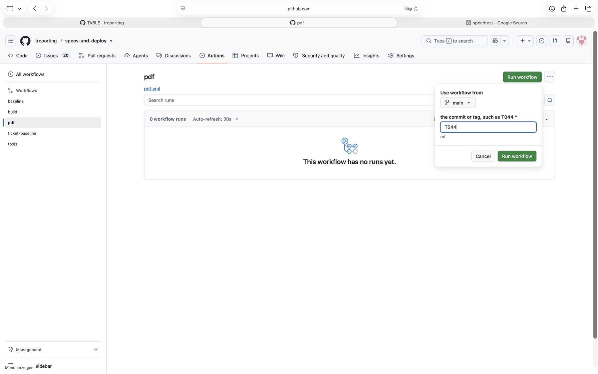
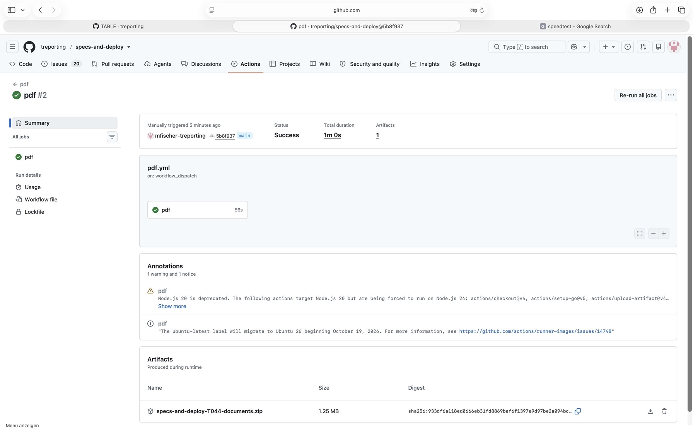
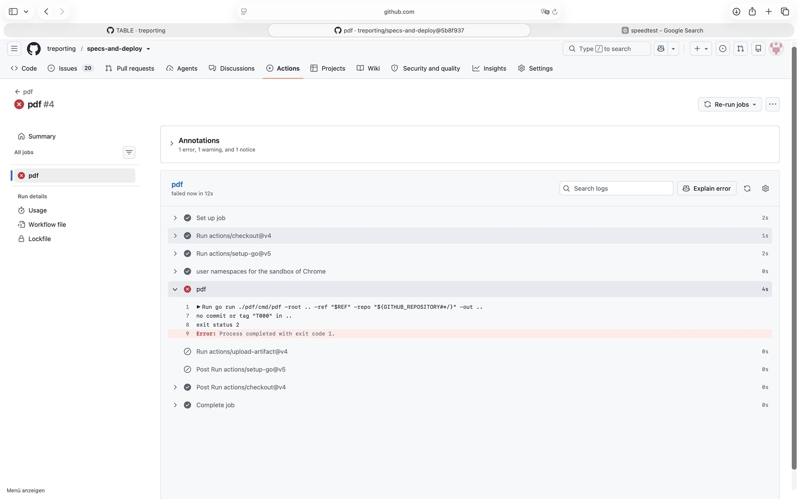

# Demonstration of SR_74 with the tag T044

## Requirement

SR_74: in pdf.yml, started by hand with a commit or tag: check it out, run pdf, and keep the ZIP as artifact of the run; fail where the commit or tag does not exist

## Configuration

- `.github/workflows/pdf.yml` and `tools/pdf` as on `main` at `5b8f937`, after the sandbox of
  Chrome was allowed on Ubuntu 24 (#395)
- the runner `ubuntu-latest`, with Google Chrome of its image
- the signed tag `T044` on `acd5bf1`

## Steps

1. Actions, pdf, Run workflow, from `main`, with the commit or tag `T044`.
2. Read the run, and download the artifact.
3. Actions, pdf, Run workflow, from `main`, with `T000`, a tag that does not exist.
4. Read the run.

The first run of pdf.yml, before #395, failed as Chrome found no sandbox; it is not part of this
demonstration.

## Expected

pdf.yml, started by hand with T044, checks it out, runs pdf, and keeps
specs-and-deploy-T044-documents.zip as artifact of the run; started with a tag that does not exist,
it fails and keeps no artifact.

## Observed

The form, with `T044`:



The run 41344400794 at `5b8f937` passed; from the log of its step pdf:

```
../specs-and-deploy-T044-documents.zip written: 17 documents and index.pdf
```



The artifact, downloaded, holds the PDF of each of the 17 documents of documents.yaml at T044, in
the folders of their paths, and index.pdf. GitHub keeps it until 2027-01-30.

The run 41344966739 with `T000` failed in its step pdf, and its upload was skipped:

```
no commit or tag "T000" in ..
exit status 2
```



## Verdict

Passed: started by hand with the tag, the workflow made the ZIP of its documents and kept it as
artifact; with a tag that does not exist, it failed and kept none.
