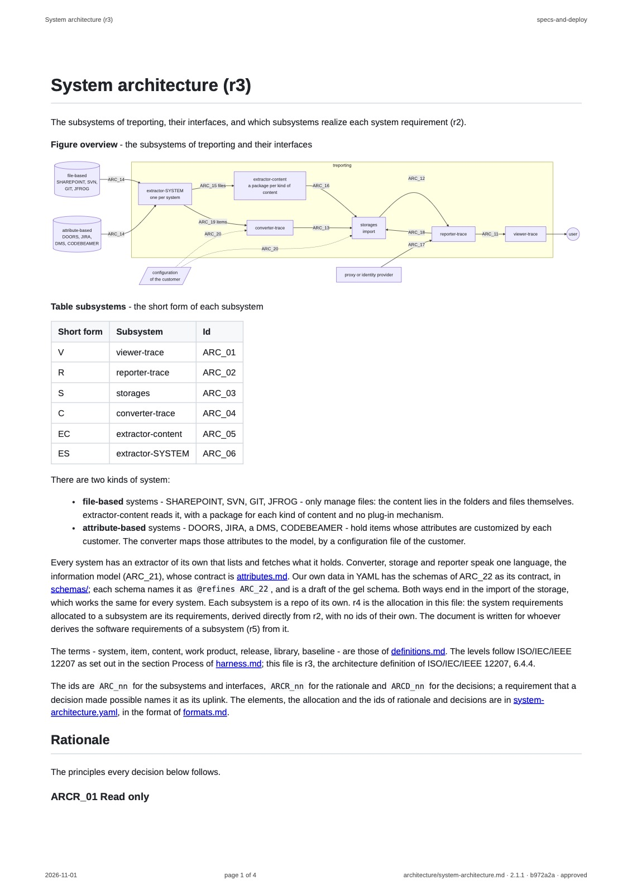

# Inspection of SR_69 and SR_70 on the pages of T044

## Requirement

SR_69: render headings, lists, tables, code, links and Mermaid diagrams of a document as GitHub shows them

SR_70: set on every page the title of the document and the name of the repo in the header, the date of the commit or tag and "page x of y" in the footer, and margins of 2 cm at top and bottom

## Configuration

The ZIP `specs-and-deploy-T044-documents.zip`, the artifact of the run 41344400794 of pdf.yml at
`5b8f937`, made on `ubuntu-latest` (verifications/20261101T205807_pdf.md).

## Steps

1. Download the artifact, and open `architecture/system-architecture.pdf` - a document with a
   Mermaid diagram, a table, lists, code and links - and `requirements/tool-requirements.pdf`.
2. Compare each with its document on GitHub at T044.
3. Render the first page of system-architecture.pdf as an image, 1600 pixels high:
   `sips -s format jpeg -Z 1600 architecture/system-architecture.pdf --out <image>`.

## Expected

A PDF of the ZIP shows headings, lists, tables, code, links and the Mermaid diagram of its document
as GitHub shows them; every page has the title of the document and the name of the repo in the
header, the date of the tag and page x of y in the footer, and margins of 2 cm at top and bottom.

## Observed

- header: "System architecture (r3)" on the left, "specs-and-deploy" on the right
- footer: "2026-11-01", the day of the commit of T044; "page 1 of 4"; and
  "architecture/system-architecture.md · 2.1.1 · b972a2a · approved"
- the diagram Figure overview drawn by Mermaid, with its nodes and edges as on GitHub; the table
  subsystems with its borders; a list; code spans such as `ARC_nn`; links such as attributes.md
- the text starts and ends 2 cm from the edge of the page, the header and footer lie in that margin
- tool-requirements.pdf shows the same, with its own title, and "requirements/tool-requirements.md
  · 15.1.1 · 48b5345 · approved" - the state at T044

## Verdict

Passed: the pages show the document as GitHub shows it, the Mermaid diagram drawn, with header,
footer and margins as required.
