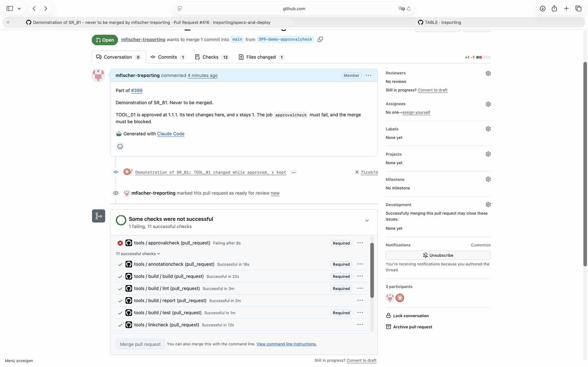

# Demonstration of SR_81 with the pull request #416

## Requirement

SR_81: on every pull request, in .github/workflows/tools.yml, check the approvals of the objects in
the files it changes against its base commit, and fail where one is reported; a pull request whose
check failed cannot be merged

## Configuration

- `.github/workflows/tools.yml`, `tools/review` and `.github/rulesets/main.json` as on `main` at
  `f946133`; the ruleset sent to GitHub with `approvalcheck` a required check
- the pull request #416 from `399-demo-approvalcheck`, commit `71ceb7d`: the text of TOOL_01,
  approved at 1.1.1, changed, its version kept; never to be merged

## Steps

1. Change the text of TOOL_01 in `requirements/tool-requirements.yaml` and keep `1.1.1`.
2. Open the pull request #416 and mark it ready for review.
3. Read the log of the job `approvalcheck` and the box of the merge.

## Expected

The job `approvalcheck` fails and names TOOL_01; it is required, and the pull request cannot be
merged. Every other check passes.

## Observed

The log of the job `approvalcheck`:

```
requirements/tool-requirements.yaml: TOOL_01: its content for x is not the one reviews/results/20261101T184254_tool-pdf.yaml reviewed at 67fae41
requirements/tool-requirements.yaml: TOOL_01: its attributes for x are not those of its approval with x 1
approvals checked, 2 findings
exit status 1
```

The pull request, ready for review: `approvalcheck` Required and failing, 11 successful checks, the
button Merge pull request disabled:



The case without findings: the job passed on #412 and #415.

## Verdict

Passed: the job checked the object in the changed file against the base commit, reported both
findings for TOOL_01 and failed, and the ruleset kept the pull request from the merge.
